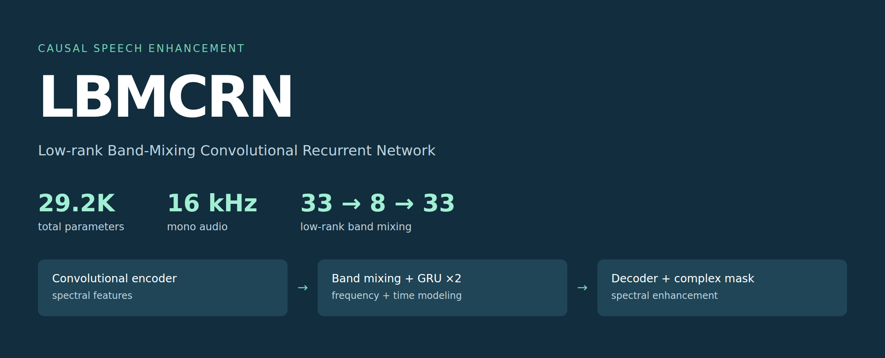
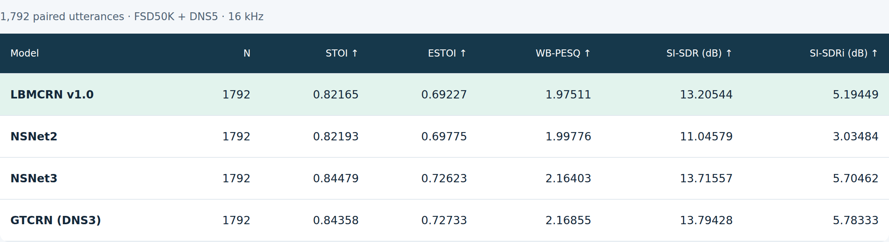
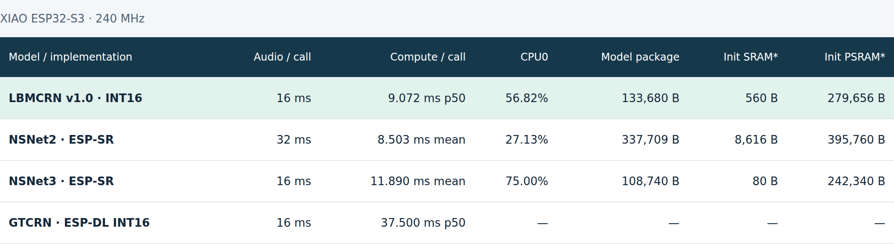

<p align="center">
  
</p>

<p align="center">
  <a href="#installation">Installation</a> ·
  <a href="#inference">Inference</a> ·
  <a href="#quality">Quality</a> ·
  <a href="#xiao-esp32-s3">XIAO ESP32-S3</a>
</p>

Lightweight speech enhancement with low-rank frequency mixing and recurrent temporal modeling.

## Architecture

LBMCRN combines a causal convolutional encoder–decoder with two recurrent bottleneck blocks. Each block uses a per-channel low-rank frequency map (33 → 8 → 33) and a temporal GRU. A complex ratio mask enhances the spectrum.

| Component | Configuration |
| --- | --- |
| Sample rate | 16 kHz |
| Analysis window / hop | 512 / 256 samples |
| Total | 29,220 parameters |

## Installation

Requires Python 3.10 or later.

```bash
git clone https://github.com/rayheto/LBMCRN.git
cd LBMCRN
python -m venv .venv
source .venv/bin/activate
pip install -r requirements.txt
```

## Inference

Enhance a WAV file or a directory of WAV files.

```bash
python infer.py --input noisy.wav --output output/enhanced.wav
python infer.py --input noisy_directory --output output/
```

Input must be mono audio at 16 kHz. Output is PCM16 with the same sample count. Pass `--device cuda` for GPU inference.

```python
import torch
from lbmcrn import LBMCRN

model = LBMCRN.from_pretrained(device="cpu")
waveform = torch.randn(1, 16000) * 0.01

with torch.inference_mode():
    enhanced = model(waveform)
```

Pretrained weights are included in `checkpoints/`.

## Quality

Mean scores across **1,792 paired development utterances**, covering FSD50K and DNS5 noise sources, with and without reverberation. Each utterance has equal weight.



[Interactive quality table](docs/quality.html) · [Evaluation details](docs/QUALITY_SUMMARY.json)

All models use identical inputs and scoring regions. LBMCRN and GTCRN use floating-point inference converted to PCM16. GTCRN uses the official DNS3 checkpoint and offline STFT wrapper. NSNet2/3 use recorded device outputs. These development inputs were used during model selection. DNSMOS SIG and human listening results are pending.

## XIAO ESP32-S3



LBMCRN v1.0 uses PSRAM for GRU lookup tables and working arrays. It was measured across three independent boots and a 10,000-frame run with zero frames exceeding the 16 ms hop. Baseline rows use historical implementations and configurations. *Memory columns show cold-init dynamic allocations; NSNet3 also uses 19,048 B of static library data. [Measurement details](docs/DEVICE.md).

## Example audio

Generate a synthetic test input and enhance it.

```bash
python test_wavs/generate.py --output /tmp/noisy.wav
python infer.py --input /tmp/noisy.wav --output /tmp/enhanced.wav
```
